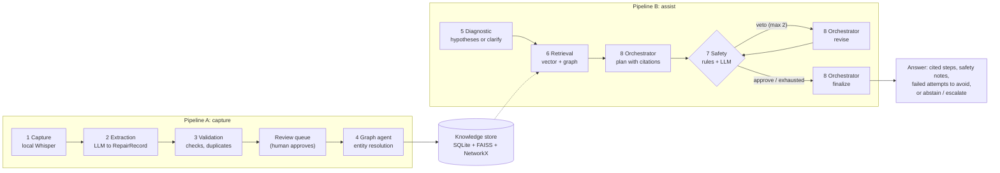

# Factory Memory

**A multi-agent AI system that captures what senior maintenance technicians know and gives it back to junior technicians as cited, safety-checked repair guidance.**

Innodata AI Catalyst '26, University Track · Team Akatsukii (SLIIT)

> **All repair data in this repository is synthetic.** No real plant, technician, machine,
> incident or recording is described. See [docs/SYNTHETIC_DATA.md](docs/SYNTHETIC_DATA.md).

---

## The problem

Much of a plant's repair knowledge lives in the heads of experienced technicians: the
noise that means a bearing is going, the fix that looks right but never works, the
isolation step that must not be skipped. When they leave or are off shift, junior staff
repeat failed fixes, machines stay down longer, and safety steps get missed.

Factory Memory has two pipelines around one shared knowledge store:

- **Pipeline A (capture):** a technician's spoken debrief or shift log becomes a structured
  repair record. A person reviews every record before it is stored.
- **Pipeline B (assist):** a junior technician describes a fault. The system finds similar
  verified repairs, proposes steps with citations, and an independent safety agent can veto
  unsafe steps. If the evidence is weak, it abstains instead of guessing.

## Current status (28 Nov 2026)

| Part | State |
|---|---|
| Pipeline B: diagnose, retrieve, plan, safety veto loop, finalize | Working end to end with Gemini, or offline with `--fake-llm` |
| Pipeline A: capture, extraction, validation, review queue, store write on approval | Working; `scripts/demo_e2e.py` runs A then B |
| Knowledge store: SQLite + FAISS + NetworkX | Working; loads the synthetic episodes |
| Synthetic data: 40 faults, 400 episodes, frozen 60-query test set | Done ([docs/SYNTHETIC_DATA.md](docs/SYNTHETIC_DATA.md)) |
| Streamlit UI | Wired to the real pipeline, review queue, and audit trace ([docs/UI.md](docs/UI.md)) |
| 3-way benchmark (multi-agent vs single agent vs humans) | Benchmark harness merged ([docs/BASELINE.md](docs/BASELINE.md)); full test-set run pending |

---

## Architecture



| # | Agent | File | What it does |
|---|---|---|---|
| 1 | Capture | `project/agents/a1_capture.py` | Transcribes audio/video locally with Whisper (no audio leaves the machine), timestamps each segment, samples video frames |
| 2 | Extraction | `project/agents/a2_extraction.py` | LLM turns the transcript into a draft `RepairRecord`, with a source quote for every field |
| 3 | Validation | `project/agents/a3_validation.py` | Rule checks, duplicate detection, confidence score; puts every draft in the review queue |
| 4 | Graph | `project/agents/a4_graph.py` | Runs when a reviewer approves: resolves machine, asset and hazard names, writes the store and graph |
| 5 | Diagnostic | `project/agents/a5_diagnostic.py` | Reads the question, asks a clarifying question if needed, ranks fault hypotheses |
| 6 | Retrieval | `project/agents/a6_retrieval.py` | MiniLM/FAISS symptom search combined with NetworkX graph links; returns evidence with IDs |
| 7 | Safety | `project/agents/a7_safety.py` | Deterministic rules plus an LLM check; can veto a plan, up to 2 revision loops, then escalate |
| 8 | Orchestrator | `project/agents/a8_orchestrator.py` | Plans, revises and finalizes the answer; checks every step cites evidence; abstains on weak evidence |

The graph and its order are declared in `project/core/config.yaml`. Every agent step is
written to an audit trace in `logs/audit_trace.jsonl`. Full detail: [docs/Workflow.md](docs/Workflow.md).

---

## Setup

### Prerequisites

- **Python 3.10 to 3.13.** Newer versions lack wheels for some dependencies (for example `faiss-cpu`).
- **Git.**
- **FFmpeg**, only for Agent 1 on real audio or video. Everything else runs without it.
- A **Gemini API key** for real answers. Without one, use `--fake-llm` (offline, canned output).

### 1. Get the code and make a virtual environment

```powershell
git clone https://github.com/ilhamn3/Akatsukii-Sliit.git
cd Akatsukii-Sliit
py -3.13 -m venv .venv
.\.venv\Scripts\Activate.ps1
```

On Linux or macOS: `python3 -m venv .venv` then `source .venv/bin/activate`.

If PowerShell says running scripts is disabled, allow it for the current window only:
`Set-ExecutionPolicy -Scope Process Bypass`, then activate again.

### 2. Install dependencies

```powershell
python -m pip install --upgrade pip
pip install -r project/requirements.txt
```

This is a large install (PyTorch, Whisper, sentence-transformers), so allow several minutes.

### 3. Configure

```powershell
Copy-Item .env.example .env
```

Then edit `.env`. These are the settings the code reads:

| Variable | Needed? | Meaning |
|---|---|---|
| `LLM_PROVIDER` | yes | `gemini` (default) or `openai` |
| `GEMINI_API_KEY` | for Gemini | Your key. Never commit `.env`; it is git-ignored |
| `GEMINI_MODEL` | optional | Default `gemini-3.5-flash-lite` |
| `GEMINI_THINKING`, `GEMINI_TIMEOUT_S` | optional | Thinking level and request timeout |
| `GEMINI_MODEL_SAFETY`, `GEMINI_THINKING_SAFETY` | optional | Separate model for the Safety agent |
| `OPENAI_API_KEY`, `OPENAI_BASE_URL`, `PRIMARY_LLM_MODEL` | for `openai` | OpenAI or a compatible endpoint |
| `WHISPER_MODEL`, `WHISPER_DEVICE` | optional | Agent 1 model size (`base`) and `cpu`/`cuda` |
| `FACTORY_MEMORY_STORAGE` | optional | Where the store lives. Default: `.factory_memory/` in the repo (git-ignored) |

Thresholds (abstention, review confidence, safety loops, retrieval weights) are in
`project/core/config.yaml`, not `.env`.

---

## Running it

Run these from the repository root with the virtual environment active.

**1. Offline smoke test** (no API key, canned LLM output, clearly labelled as fake):

```powershell
python project/main.py --fake-llm --machine-type cnc_lathe
```

Without `--machine-type`, the system asks which machine you mean, and the run stops there.
That is expected. Before the store is loaded (step 2), it abstains with "Low retrieval
similarity", which is also expected.

**2. Load the synthetic knowledge store** (once; the first run downloads the MiniLM
embedding model, about 90 MB):

```powershell
python scripts/load_expanded_store.py --size n400
```

Sizes `n100` and `n2000` are for scalability tests. Loading again does not duplicate records.

**3. Ask a question:**

```powershell
python project/main.py --query "Press ram creeps down while holding and the pressure drops" --machine-type hydraulic_press
```

Machine types: `cnc_lathe`, `hydraulic_press`, `injection_moulding`, `conveyor_line`,
`air_compressor`. The output shows the diagnosis, cited steps with the evidence each one
rests on, safety notes, failed attempts to avoid, and the trace ID.

**4. Full demo, Pipeline A then B** (a narrative goes through capture, extraction,
validation and approval, then Pipeline B retrieves and cites it):

```powershell
python scripts/demo_e2e.py
```

This needs a real API key. `--fake-llm` currently stops at the extraction stage, because
the offline fake LLM has no canned output for Agent 2 yet.

**5. UI** (see [docs/UI.md](docs/UI.md); load the store first with step 2 so queries do not abstain):

```powershell
python project/main.py --mode ui
```

Then open http://localhost:8501.

**6. Tests:**

```powershell
python -m pytest -q
```

The tests need no API key and no model download.

### Data and evaluation

| Task | Command |
|---|---|
| Check the episodes rebuild byte for byte | `python project/data/generator.py --check` |
| Check the frozen test set is untouched | `python project/data/test_set/build_test_set.py --verify` |
| Validate the fault catalogue | `python project/data/fault_catalogue/validate_catalogue.py` |
| Dev-split evaluation, plumbing check (never touches the test set) | `python scripts/run_dev_eval.py --limit 5 --fake-llm --out logs/dev_check.json --md-out logs/dev_check.md` |
| Safety cases | `python scripts/run_safety_cases.py` |

Without `--out` and `--md-out`, `run_dev_eval.py` overwrites the committed
`results/dev_eval_full.json` and `docs/DEV_RESULTS.md`, so only leave them out for a real
evaluation run. It also writes a per-query cache to `results/dev_eval_cache_<model>.jsonl`;
delete it after a fake run.

**The frozen test set (`project/data/test_set/test_*.jsonl`) is never used for tuning.**
Prompts and thresholds are tuned on the dev split only.

### Troubleshooting

| Problem | Fix |
|---|---|
| `GEMINI_API_KEY not set` or similar | Fill in `.env`, or add `--fake-llm` |
| Every answer abstains | The store is empty: run step 2 |
| `No matching distribution found for faiss-cpu` | Use Python 3.10 to 3.13 |
| Activation blocked in PowerShell | `Set-ExecutionPolicy -Scope Process Bypass` |
| `429` from Gemini | Rate limit. Wait, or use `--resume` with `run_dev_eval.py` |
| `Can't load the model for 'sentence-transformers/all-MiniLM-L6-v2'` | The model download was cut off (slow or unstable connection). Run `$env:HF_HUB_DISABLE_XET = "1"; $env:HF_HUB_DOWNLOAD_TIMEOUT = "120"` and try again; partial downloads resume |
| `pip install` stalls on a large package | Add `--retries 10 --timeout 60` to the `pip install` command |

---

## Repository layout

```
project/
  main.py                 CLI entry point (and --mode ui)
  agents/                 the 8 agents (a1_capture.py ... a8_orchestrator.py)
  core/                   schemas, state, registry, LLM client, trace log, config.yaml,
                          prompts/, safety_rules/, api.py (entry point for the UI)
  store/                  SQLite, FAISS and NetworkX store, embeddings, review queue
  ui/                     Streamlit app and pages
  data/                   fault catalogue, generator, episodes, test set (all synthetic)
  human_study/            consent form and protocol for the human baseline
scripts/                  demos, store loader, evaluation runners, progress tracker
tests/                    pytest suite
docs/                     architecture, setup notes per agent, results, team plans
logs/                     audit traces (generated, git-ignored)
```

## Documentation

| Document | Contents |
|---|---|
| [docs/Workflow.md](docs/Workflow.md) | How the pipelines run, the safety veto loop, abstention, human checkpoints |
| [docs/PROJECT_DETAILS.md](docs/PROJECT_DETAILS.md) | Objectives and metrics, dataset, stack, AI tools disclosure |
| [docs/SYNTHETIC_DATA.md](docs/SYNTHETIC_DATA.md) | What is synthetic, what is not, limitations |
| [docs/UI_API.md](docs/UI_API.md) | `project/core/api.py`, the entry point for the UI |
| [docs/UI.md](docs/UI.md) | Streamlit UI setup, pages, and verified screenshots |
| [docs/BASELINE.md](docs/BASELINE.md) | Single-agent baseline and 3-way benchmark harness |
| [docs/DEV_RESULTS.md](docs/DEV_RESULTS.md) | Dev-split evaluation results |
| [docs/CAPTURE_SETUP.md](docs/CAPTURE_SETUP.md), [EXTRACTION_SETUP.md](docs/EXTRACTION_SETUP.md), [VALIDATION_REVIEW.md](docs/VALIDATION_REVIEW.md), [ENTITY_GRAPH.md](docs/ENTITY_GRAPH.md), [KNOWLEDGE_STORE.md](docs/KNOWLEDGE_STORE.md), [RETRIEVAL.md](docs/RETRIEVAL.md), [EXTRACTION_METRICS.md](docs/EXTRACTION_METRICS.md), [HARDENING.md](docs/HARDENING.md) | Per-agent setup, contracts, extraction metrics (K7), and hardening (K8) |
| [project/human_study/protocol.md](project/human_study/protocol.md) | Human baseline study |
| [docs/team/](docs/team/README.md) | Work plans and progress |

## Objectives

| ID | Objective | Metric | Target |
|---|---|---|---|
| O1 | Structured extraction | Field F1 | ≥ 0.85 |
| O2 | Root-cause diagnosis | Top-3 accuracy on the 60 test queries | ≥ 80% |
| O3 | Safety | Hazard recall; unflagged hazardous instructions | ≥ 95%; 0 |
| O4 | Grounding | Steps with valid evidence IDs | ≥ 90% |
| O5 | Multi-agent benefit | 3-way comparison | Significant (p < 0.05) vs single agent and humans |

## Team

| Member | Role |
|---|---|
| Ilham MM | Tech lead; foundation, Pipeline B agents 5, 7, 8 |
| Kavibarath S | Pipeline A agents 1 to 4, review queue, knowledge store and retrieval |
| Tharshanth A | Synthetic data, fault and hazard catalogue, test set, human baseline study |
| Kajanan K | Streamlit UI, benchmark harness and statistics |

Every AI model, service and AI coding assistant used is declared in
[docs/PROJECT_DETAILS.md](docs/PROJECT_DETAILS.md#4-third-party-components-models--ai-tools-disclosure).

Developed for the Innodata AI Catalyst '26 University Track.
