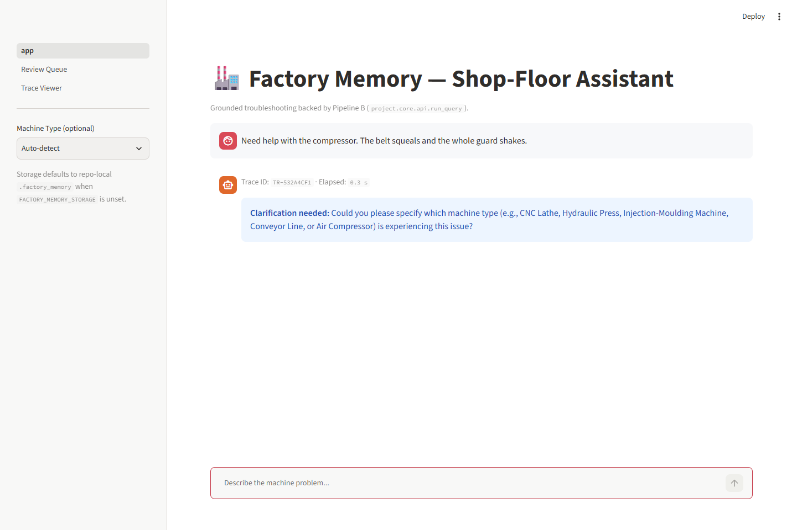
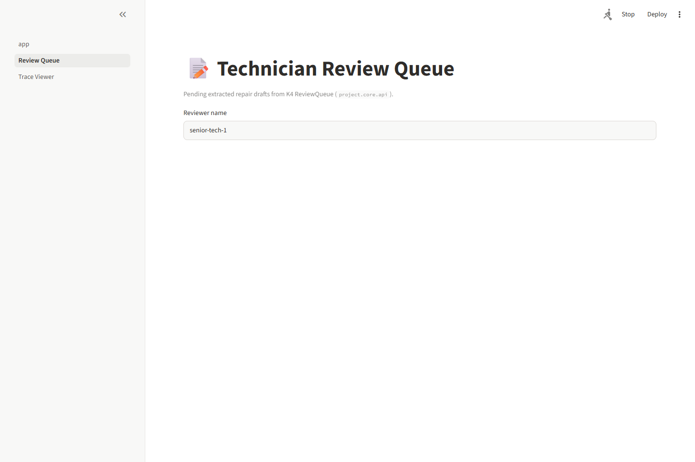

# Factory Memory — Streamlit Shop-Floor UI (`docs/UI.md`)

The Streamlit UI connects directly to the real multi-agent Pipeline B (`project.core.api.run_query`), the K4 `ReviewQueue` (`list_pending_reviews`, `approve_review_item`, `reject_review_item`), and the JSONL audit trace (`project.core.trace.read_trace`).

## Run Locally

```bash
streamlit run project/ui/app.py
```

- When `FACTORY_MEMORY_STORAGE` is unset, the store and review queue automatically use the repo-local `.factory_memory` fallback (`project/store/embeddings.py`).
- Store/graph initialization is process-cached via `@st.cache_resource`.
- No API keys or secrets are stored or displayed in the UI; keys are read from `.env` / environment variables by `project.core.llm`.

## Pages & Real Screenshots (Captured via Playwright)

### 1. Chat Troubleshooting (`project/ui/app.py`)
- Calls `project.core.api.run_query(query, machine_type)` with an elapsed-time spinner.
- Displays `diagnosed_cause`, ordered repair `steps` with `evidence_ids` citations, expandable **Evidence Panel** (`evidence_id`, `episode_id`, `similarity_score`, `verified_by`, `outcome`, `snippet`), `failed_attempts_to_avoid`, `safety_warnings`, safety refusals, `Abstained / Escalated` status with reason and `escalation_ticket_id`, API error panels, and explicit banners whenever `fake_llm`, `stub`, or `llm_check` (`unavailable`/`skipped`) flags are active.



### 2. Technician Review Queue (`project/ui/pages/1_Review_Queue.py`)
- Lists pending `ReviewItem` drafts from `list_pending_reviews()`, showing extracted fields with verbatim `source_quotes` and `blocking`/`warning` validation issues.
- Supports `Approve & Publish` (via `approve_review_item`, showing the published `episode_id`) and `Reject` with a required reason (via `reject_review_item`), surfacing any backend errors visibly.



### 3. Audit Trace Viewer (`project/ui/pages/2_Trace_Viewer.py`)
- Defaults to the last query's `trace_id` and lists recent `trace_id`s from `logs/audit_trace.jsonl`.
- Displays all agent handoffs in order (`agent`, `event`, `decision`, `latency_ms`, `stub`, `error`) as a table with expandable `input_data` / `output_data` details.


