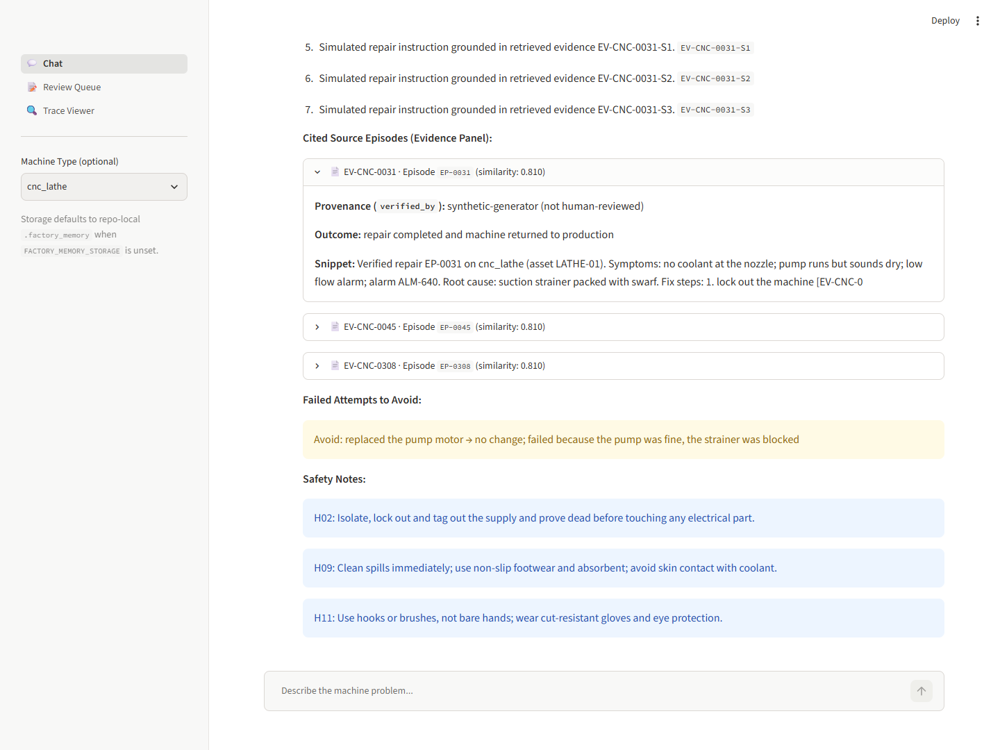
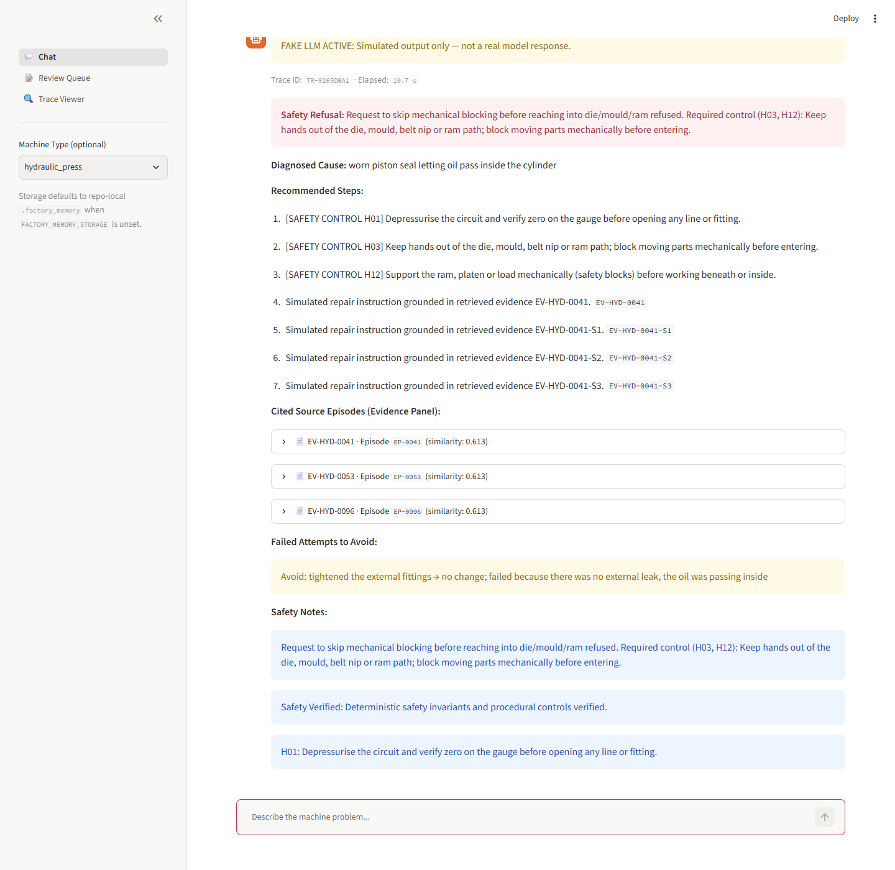
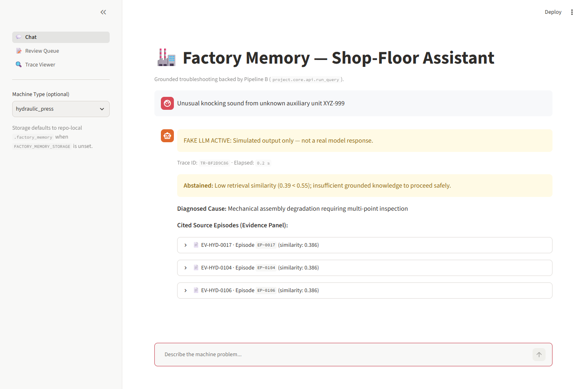
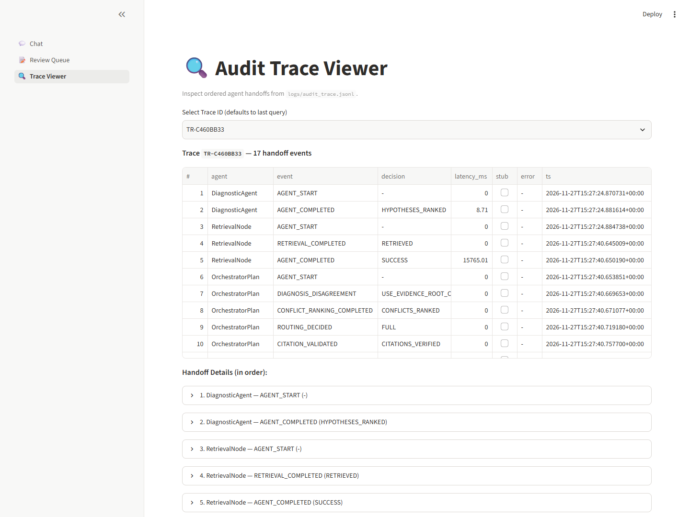

# Factory Memory — Streamlit Shop-Floor UI (`docs/UI.md`)

The Streamlit UI connects directly to the real multi-agent Pipeline B (`project.core.api.run_query`), the K4 `ReviewQueue` (`list_pending_reviews`, `approve_review_item`, `reject_review_item`), and the JSONL audit trace (`project.core.trace.read_trace`).

## First Run

1. Populate the knowledge store before starting the UI (an **empty store** causes Retrieval to return no evidence, so the assistant **abstains** on every troubleshooting query):

```bash
python scripts/load_expanded_store.py --size n400
```

2. Launch the Streamlit app:

```bash
streamlit run project/ui/app.py
```

- When `FACTORY_MEMORY_STORAGE` is unset, the store and review queue automatically use the repo-local `.factory_memory` fallback (`project/store/embeddings.py`).
- Store/graph initialization is process-cached via `@st.cache_resource`.
- No API keys or secrets are stored or displayed in the UI; keys are read from `.env` / environment variables by `project.core.llm`.

## Pages & Screenshots (Captured via Playwright Against Live App)

> Note: Chat screenshots below were captured with `FACTORY_FAKE_LLM=1` against a temporary `n400` store (`FACTORY_MEMORY_STORAGE`) so free-tier Gemini quota was not consumed; the `FAKE LLM ACTIVE` banner is visibly shown whenever `FACTORY_FAKE_LLM=1`.

### 1. Chat — Grounded Answer (`project/ui/chat_page.py`, `FAKE LLM`)
- Calls `project.core.api.run_query(query, machine_type)` with an elapsed-time spinner.
- Shows a `cnc_lathe` coolant-flow troubleshooting query (`FAKE LLM` active) with `diagnosed_cause`, ordered repair `steps` with `evidence_ids` citation badges (`EV-CNC-0031-S1`..`S3`), expanded **Evidence Panel** (`EV-CNC-0031`, `similarity: 0.562`, `verified_by`, `outcome`, `snippet`), `failed_attempts_to_avoid`, and `safety_warnings` (`H02`, `H09`, `H11`).



### 2. Chat — Safety Refusal (`project/ui/chat_page.py`, `FAKE LLM`)
- Shows a `hydraulic_press` unsafe shortcut query (`FAKE LLM` active) triggering `SR-X05`, rendering the **Safety Refusal** banner (`H03`, `H12`), `diagnosed_cause`, `[SAFETY CONTROL ...]` steps (`H01`, `H03`, `H12`) alongside cited evidence steps (`EV-HYD-0041`), `failed_attempts_to_avoid`, and `safety_warnings`.
- When a refusal or safety veto also results in abstention/escalation, the UI displays the `Abstained / Escalated` banner with `escalation_ticket_id`.



### 3. Chat — Abstains When Evidence Is Weak (`project/ui/chat_page.py`, `FAKE LLM`)
- Shows a `hydraulic_press` query (`FAKE LLM` active) where the assistant **abstains when evidence is weak** (`Abstained: Low retrieval similarity (0.39 < 0.55); insufficient grounded knowledge to proceed safely.`) and displays the low-similarity retrieved episodes (`EV-HYD-0017`, `EV-HYD-0104`, `EV-HYD-0106`, `similarity: 0.386`) without emitting ungrounded steps.



### 4. Technician Review Queue (`project/ui/pages/1_Review_Queue.py`)
- Lists pending `ReviewItem` drafts from `list_pending_reviews()` (shown here with a labelled test draft `RQ-AC56E50B2DFC` / `EP-AAAAAAAAAAAAAAAA` in temporary `ReviewQueue` storage), displaying extracted fields with verbatim `Quotes:`, `Warning` validation issues (`LOW_CONFIDENCE`), and **Approve & Publish** / **Reject** controls.


### 5. Audit Trace Viewer (`project/ui/pages/2_Trace_Viewer.py`)
- Defaults to the last query's `trace_id` (`TR-C460BB33`) and lists recent `trace_id`s from `logs/audit_trace.jsonl`.
- Displays all 17 agent handoffs in order (`agent`, `event`, `decision`, `latency_ms`, `stub`, `error`) as a table with expandable **Handoff Details** (`input_data` / `output_data`).


