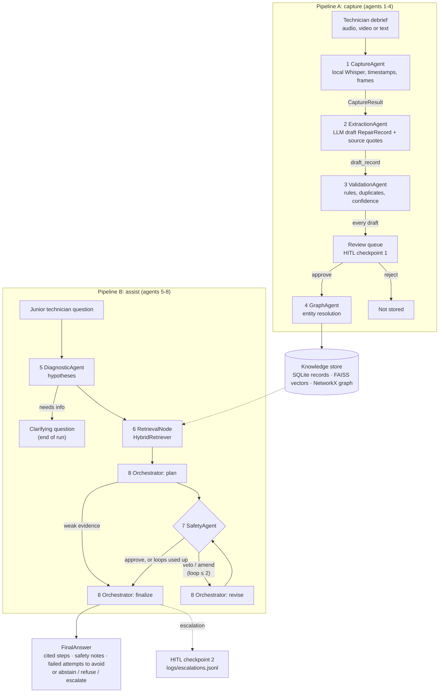

# Factory Memory: Workflow

How the two pipelines run, how agents hand off to each other, and where people stay in
control. This describes the code on `main` as of 26 Nov 2026. The graph itself is declared
in `project/core/config.yaml` and built by `project/core/registry.py`.

All repair data used here is synthetic ([SYNTHETIC_DATA.md](SYNTHETIC_DATA.md)).

---

## 1. Overview



| Agent | Class and file | Pipeline |
|---|---|---|
| 1 | `CaptureAgent`, `project/agents/a1_capture.py` | A |
| 2 | `ExtractionAgent`, `project/agents/a2_extraction.py` | A |
| 3 | `ValidationAgent`, `project/agents/a3_validation.py` | A |
| 4 | `GraphAgent`, `project/agents/a4_graph.py` | A, at approval time |
| 5 | `DiagnosticAgent`, `project/agents/a5_diagnostic.py` | B |
| 6 | `RetrievalNode` wrapping `HybridRetriever`, `project/core/stubs/retrieval_node.py` and `project/agents/a6_retrieval.py` | B |
| 7 | `SafetyAgent`, `project/agents/a7_safety.py` | B |
| 8 | `OrchestratorAgent` in three phases (plan, revise, finalize), `project/agents/a8_orchestrator.py` | B |

---

## 2. Pipeline A: capture

Registered graph: `CaptureAgent -> ExtractionAgent -> ValidationAgent -> end`.

1. **Capture (agent 1).** Whisper runs locally (model from `WHISPER_MODEL`, default `base`);
   no audio is sent to an API. FFmpeg reads the media. The output is a `CaptureResult`:
   the full text, timestamped segments each with an evidence ID, the source file's SHA-256,
   and sampled frames for video. Poor audio is flagged for review. Setup:
   [CAPTURE_SETUP.md](CAPTURE_SETUP.md).
2. **Extraction (agent 2).** An LLM fills a draft `RepairRecord` (machine, symptoms, steps,
   tools, parts, root cause, failed attempts, safety warnings). Each field must carry a
   quote from the transcript, and quotes are checked against the source. Unknown fields stay
   empty instead of being guessed. Setup: [EXTRACTION_SETUP.md](EXTRACTION_SETUP.md).
3. **Validation (agent 3).** Rule-based checks, no LLM: required fields, failed attempts
   that contradict a step, the same recording submitted twice (blocks approval), near
   duplicates (symptom cosine ≥ `duplicate_similarity_threshold`, 0.90, on the same
   machine; a warning), and a confidence score. **Every draft goes to the review queue**, whatever its
   score, because the score is not calibrated. See [VALIDATION_REVIEW.md](VALIDATION_REVIEW.md).
4. **Review and store (agent 4).** A named reviewer approves (optionally with corrections)
   or rejects each item. Only `ReviewQueue.approve()` publishes a record: it calls
   `GraphAgent`, which resolves machine, asset and hazard names using
   `project/data/entities/aliases.yaml` and writes the verified episode to the store. That is
   why agent 4 is not a node in the Pipeline A graph. Nothing reaches the store without a
   human decision. See [ENTITY_GRAPH.md](ENTITY_GRAPH.md).

The store keeps each verified episode in SQLite, its symptom embedding (MiniLM, 384
dimensions) in FAISS, and machine, asset, hazard and episode links in a NetworkX graph.
See [KNOWLEDGE_STORE.md](KNOWLEDGE_STORE.md). The synthetic episodes are loaded directly
with `scripts/load_expanded_store.py`, marked as verified by the generator.

`scripts/demo_e2e.py` runs the whole of Pipeline A on one synthetic narrative, approves it,
then asks Pipeline B a question that should retrieve it.

---

## 3. Pipeline B: assist

Entry points: `python project/main.py --query "..."`, or `project.core.api.run_query(...)`
for the UI ([UI_API.md](UI_API.md)).

1. **Diagnose (agent 5).** Reads the question and machine type and ranks fault hypotheses.
   If key information is missing, it returns a clarifying question and the run ends there
   (`check_clarification`).
2. **Retrieve (agent 6).** `HybridRetriever` scores each verified episode as
   `1 - (1 - cosine)(1 - 0.5·graph)(1 - 0.1·asset)`. Graph and asset links can only add
   support, so the abstention threshold stays on the cosine scale. It returns the top
   `k = 3` as evidence items with evidence IDs, outcomes and failed attempts. Weights were
   fixed before any evaluation. See [RETRIEVAL.md](RETRIEVAL.md).
3. **Plan (agent 8, plan phase).** In order:
   - **Abstain** if there is no evidence or retrieval confidence is below
     `abstention_similarity_threshold` (0.55).
   - **Abstain** if the context involves high energy (over 50 V or 10 bar) and no evidence
     shows an isolation or bleed-down step.
   - **Rank conflicting episodes** with `conflict_ranking_weights` (worked +0.40, failed
     −0.50, verified by senior +0.25, recency 0.15, similarity 0.20). Fixes that failed
     elsewhere become "failed attempts to avoid". If the evidence disagrees with the
     diagnostic hypothesis, the evidence's root cause wins.
   - **Draft steps** with the LLM, then drop any step whose citations are not real evidence
     IDs from this retrieval. Required catalogue safety controls go first. If no cited step
     survives, abstain.
4. **Safety check (agent 7).** Deterministic rules run first, then an LLM review. The
   rules' verdict cannot be weakened by the LLM. A request to skip a safety control is
   refused. The verdict is `approve`, `amend` or `veto`.
5. **Revise (agent 8, revise phase).** On amend or veto, the orchestrator rewrites the plan
   with the safety feedback and sends it back to agent 7. At most
   `safety_max_revision_loops` (2) revisions are allowed.
6. **Finalize (agent 8, finalize phase).** Produces the `FinalAnswer`. If safety still
   has not approved, safety wins: no steps are returned, the answer is marked abstained and
   escalated, and a ticket is written to `logs/escalations.jsonl`.

### What the answer contains (`FinalAnswer`, `project/core/schemas.py`)

`machine_type`, `symptoms`, `diagnosed_cause`, `steps` (each with `instruction` and
`evidence_ids`), `safety_warnings`, `failed_attempts_to_avoid`, `abstained` and
`abstention_reason`, `refusal`, `escalated` and `escalation_ticket_id`, and `trace_id`.

---

## 4. Shared state and the audit trace

Agents share one `BlackboardState` (`project/core/state.py`), a typed dictionary passed
through the LangGraph graph. Each agent returns only the fields it changes. Main groups:

| Group | Fields |
|---|---|
| Request | `session_id`, `trace_id`, `worker_id`, `machine_type`, `machine_id`, `raw_query` |
| Pipeline A | `capture_result`, `draft_record`, `validation_report`, `review_item_id`, `verified_episode`, `entity_links` |
| Diagnosis | `clarification_needed`, `clarification_question`, `ranked_hypotheses`, `selected_hypothesis` |
| Retrieval | `evidence`, `retrieved_episodes`, `retrieval_confidence`, `failed_attempts_to_avoid` |
| Safety loop | `candidate_steps`, `safety_violations`, `safety_loop_count`, `safety_approved`, `escalated_to_supervisor` |
| Result | `conflicts`, `final_answer`, `abstained`, `escalated`, `abstention_reason` |
| Bookkeeping | `messages`, `errors`, `audit_trace`, `metadata` |

Every agent step appends one JSON line to `logs/audit_trace.jsonl` (`project/core/trace.py`):

```json
{"ts": "2026-11-26T09:14:02.511+00:00", "trace_id": "TR-1A2B3C4D", "session_id": "SES-9F8E7D6C",
 "agent": "OrchestratorPlan", "stub": false, "event": "ORCHESTRATOR_ABSTAIN",
 "input_digest": {"retrieval_confidence": 0.41, "threshold": 0.55},
 "output_digest": {"reason": "Low retrieval similarity (0.41 < 0.55); ..."},
 "decision": "ABSTAIN", "latency_ms": 3.2, "error": null}
```

The `trace_id` printed with each answer finds every line for that run. The UI's trace
viewer page currently shows mock data in a simpler format; it is not yet reading this file.

---

## 5. Human checkpoints

| Checkpoint | When | Who | Status |
|---|---|---|---|
| 1. Review queue | Every extracted draft, before it can be stored | A named reviewer (maintenance lead) approves, corrects or rejects | Working (`project/store/review_queue.py`; UI page on mock data) |
| 2. Safety escalation | Safety still objects after 2 revisions | Safety officer or senior technician, from the ticket in `logs/escalations.jsonl` | Ticket written; no UI yet |
| 3. Repair feedback | After a junior technician tries the guidance | The technician reports worked, partly worked or failed | Planned, not built. Failed fixes would go back through Pipeline A |

---

## 6. Settings that change behaviour

All in `project/core/config.yaml`:

| Setting | Value | Effect |
|---|---|---|
| `abstention_similarity_threshold` | 0.55 | Below this retrieval confidence, the system abstains |
| `safety_max_revision_loops` | 2 | Revisions allowed before escalation |
| `confidence_threshold_review` | 0.75 | Shown to reviewers; does not skip review |
| `duplicate_similarity_threshold` | 0.90 | Near-duplicate warning in validation |
| `retrieval.k`, `graph_weight`, `asset_weight` | 3, 0.5, 0.1 | Hybrid retrieval |
| `conflict_ranking_weights` | see section 3 | Ranking of conflicting episodes |
| `retrieval_backend` | `real` | `stub` (or `FACTORY_STUB_RETRIEVAL=1`) uses placeholder evidence for testing |

These were set on the dev split or before any evaluation. The frozen test set is not used
for tuning.

---

## 7. Evaluation

- **Dev split:** `scripts/run_dev_eval.py` runs Pipeline B on the 20 dev queries and writes
  `docs/DEV_RESULTS.md`. It never reads the test set.
- **Test set:** 60 frozen queries (20 easy, 20 medium, 10 hard, 10 adversarial) with gold
  answers, in `project/data/test_set/`, checked with `build_test_set.py --verify`.
- **Three-way comparison:** the multi-agent system against a single-agent baseline and
  human volunteers working from the same repair notes. Answers from all three are graded
  blind against the gold answers. See [project/human_study/protocol.md](../project/human_study/protocol.md).
- **Scalability:** stores of 100, 400 and 2,000 episodes (`scripts/load_expanded_store.py --size ...`).
