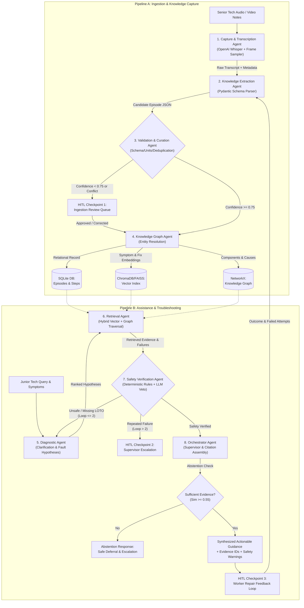

# Factory Memory — Operational Workflow & System Protocols

This document specifies the technical operational workflows, inter-agent communication protocols, safety veto state machines, Human-in-the-Loop (HITL) checkpoints, and execution phases of **Factory Memory**.

---

## 1. End-to-End System Architecture

Factory Memory coordinates eight specialized agents grouped into two sequential/concurrent pipelines interacting through a shared hybrid knowledge store and an immutable blackboard state.



---

## 2. Pipeline A — Ingestion & Knowledge Capture

### Step-by-Step Data & Control Flow
1. **Audio/Video Input**: Veteran technician uploads recorded post-repair debriefs, voice memos, or phone video clips from the shop floor.
2. **Audio Transcription & Sampling (Agent 1)**:
   - Whisper transcribes spoken audio into text with timestamp segments.
   - For video inputs, keyframes are sampled at notable repair transitions (e.g., component disassembly).
3. **Structured Extraction (Agent 2)**:
   - LLM extracts structured fields strictly adhering to the `RepairEpisodeSchema` (Pydantic).
   - Mandatory fields: `machine_type`, `machine_id`, `subsystem`, `symptom_observed`, `root_cause`, `tools_required`, `parts_replaced`, `action_steps`, `failed_attempts`, `safety_warnings`.
4. **Validation, Curation & Deduplication (Agent 3)**:
   - Schema conformance check (e.g., valid pressure/torque units: PSI, bar, Nm).
   - Semantic duplicate check: Computes cosine similarity of `(machine_type + symptom_observed)` against existing database episodes.
   - Computes an overall Extraction Confidence Score $C \in [0.0, 1.0]$.
   - If $C < 0.75$ or conflicting repairs are detected, the episode is diverted to **HITL Checkpoint 1 (Ingestion Review Queue)**.
5. **Knowledge Graph Ingestion & Indexing (Agent 4)**:
   - Resolves entity aliases (e.g., "spindle encoder" vs "rotary position sensor").
   - Generates unique `episode_id` (e.g., `EP-CNC-0042`) and granular `evidence_id` tags (e.g., `EV-CNC-0042-S3`).
   - Inserts relational records into **SQLite**, generates dense embeddings for symptoms and fixes into **ChromaDB/FAISS**, and updates causal edges in **NetworkX** (`Component` $\xrightarrow{\text{has\_fault}}$ `Symptom` $\xrightarrow{\text{caused\_by}}$ `RootCause` $\xrightarrow{\text{resolved\_by}}$ `FixAction`).

---

## 3. Pipeline B — Assistance & Knowledge Retrieval

### Step-by-Step Data & Control Flow
1. **Worker Query Intake**: Junior technician inputs observed symptoms, machine type, and optional error code via Streamlit UI.
2. **Diagnostic Hypotheses Generation (Agent 5)**:
   - Parses the query. If essential information is missing (e.g., hydraulic oil level or line pressure), generates a targeted clarifying question before proceeding.
   - Proposes 1 to 3 ranked fault hypotheses based on symptom topology.
3. **Hybrid Knowledge Retrieval (Agent 6)**:
   - **Vector Search**: Queries ChromaDB/FAISS for top-$k$ nearest historical repair episodes using semantic embeddings of current symptoms.
   - **Graph Traversal**: Traverses NetworkX graph starting from `MachineType` and `Subsystem` nodes to locate co-occurring failure modes, prerequisite component checks, and historically documented `failed_attempts`.
   - Extracts relevant evidence chunks with their unique `evidence_id` values.
4. **Safety Verification & Veto Loop (Agent 7)**:
   - Passes candidate instructions through a deterministic rule check for mandatory safety protocols:
     - **LOTO (Lockout / Tagout)** verification for electrical/mechanical isolation.
     - **Residual pressure bleeding** for hydraulic and pneumatic circuits.
     - **Thermal / chemical personal protective equipment (PPE)** requirements.
   - Performs LLM-based safety verification checking whether any step violates standard OSHA / ISO 13849 machinery safety standards.
   - **Veto Execution**: If a hazard is detected or LOTO is omitted, the agent vetoes the plan, appends an explicit revision notice, and routes back to Agent 5.
   - **Loop Limit**: Maximum **2 revision loops** permitted. If the plan remains unsafe after 2 iterations, the system terminates automatic generation and escalates to **HITL Checkpoint 2 (Supervisor Escalation)**.
5. **Orchestration, Grounding & Response Generation (Agent 8)**:
   - **Abstention Policy**: If maximum retrieval similarity score is $< 0.55$, the Orchestrator refuses to hallucinate, explicitly declaring: *"Insufficient historical evidence to safely guide this repair. Please escalate to a senior technician."*
   - Otherwise, assembles the step-by-step guidance, prepends mandatory PPE/LOTO safety alerts, annotates every step with `[Evidence: EV-XXXX]`, highlights common *failed attempts* to avoid, and logs full trace to JSONL.

---

## 4. Inter-Agent Communication Protocol & State Machine

Agents communicate through a typed, shared blackboard state implemented via **LangGraph**. Every transition mutates or appends to a structured state dictionary.

### Blackboard State Schema (`FactoryBlackboardState`)
```python
from typing import List, Dict, Any, Optional
from pydantic import BaseModel, Field

class BlackboardState(BaseModel):
    # Session & Query Context
    session_id: str
    worker_id: str
    machine_type: str
    machine_id: Optional[str] = None
    raw_query: str
    clarification_turns: int = 0
    clarification_needed: bool = False
    clarification_question: Optional[str] = None

    # Diagnostic Phase
    ranked_hypotheses: List[Dict[str, Any]] = Field(default_factory=list)
    selected_hypothesis: Optional[Dict[str, Any]] = None

    # Retrieval Phase
    retrieved_episodes: List[Dict[str, Any]] = Field(default_factory=list)
    graph_subgraph_nodes: List[str] = Field(default_factory=list)
    failed_attempts_retrieved: List[str] = Field(default_factory=list)
    retrieval_confidence: float = 0.0

    # Safety Veto Loop State
    candidate_steps: List[Dict[str, Any]] = Field(default_factory=list)
    safety_violations: List[str] = Field(default_factory=list)
    safety_loop_count: int = 0
    safety_approved: bool = False
    escalated_to_supervisor: bool = False

    # Final Output & Audit
    synthesized_guidance: Optional[str] = None
    citations: List[str] = Field(default_factory=list)
    abstention_triggered: bool = False
    audit_trace: List[Dict[str, Any]] = Field(default_factory=list)
```

### JSONL Audit Log Specification
Every agent interaction appends an immutable record to `logs/audit_trace.jsonl`:
```json
{
  "timestamp": "2026-11-20T23:00:00Z",
  "session_id": "SES-20261120-001",
  "agent_name": "SafetyVerificationAgent",
  "action": "VETO",
  "loop_iteration": 1,
  "violations": ["Missing hydraulic pressure discharge step before manifold disassembly"],
  "evidence_ids_evaluated": ["EV-HYD-0012-S2"],
  "blackboard_delta": {"safety_approved": false, "safety_loop_count": 1}
}
```

---

## 5. Conflict Resolution, Safety Veto & Abstention Rules

### 1. Conflict Resolution Matrix
When multiple historical episodes recommend differing repair procedures for similar symptoms:
- **Rule 1 (Success Recency & Count):** Procedures verified by $\ge 2$ senior technicians override single-instance repairs.
- **Rule 2 (Failed Attempt Veto):** If Procedure A was subsequently logged as a `failed_attempt` in a later episode of the same machine variant, Procedure A is disqualified.
- **Rule 3 (Specific Over General):** Exact `machine_id` records take precedence over general `machine_type` matches.

### 2. Safety Veto Loop Policy
```
If safety_violations exist:
    Increment safety_loop_count
    If safety_loop_count <= 2:
        Return to Diagnostic/Retrieval Agent with feedback: "Hazard detected: {violations}. Modify procedure."
    Else:
        Set escalated_to_supervisor = True
        Trigger HITL Checkpoint 2
        Halt automated assistance
```

### 3. Abstention Policy
To prevent hazardous hallucinations in an industrial plant:
- **Condition 1:** Semantic similarity of top retrieved repair episode $< 0.55$.
- **Condition 2:** Missing Lockout/Tagout specifications for electrical inputs $> 50\text{V}$ or hydraulic pressures $> 10\text{ bar}$.
- **Action:** Output standard safe shutdown procedure + issue supervisor dispatch notification.

---

## 6. The Three Human-in-the-Loop (HITL) Checkpoints

1. **HITL Checkpoint 1 (Ingestion Review Queue)**:
   - **Trigger:** Validation Agent flags low confidence ($C < 0.75$), contradictory tool/part specs, or duplicate ambiguities.
   - **User:** Maintenance Engineering Lead.
   - **Action:** Accept, modify fields via Streamlit Review Tab, or reject raw entry.
2. **HITL Checkpoint 2 (Safety Supervisor Escalation)**:
   - **Trigger:** Safety Agent veto loop exceeds 2 iterations or an unresolvable hazardous sequence is detected.
   - **User:** Certified Plant Safety Officer / Master Technician.
   - **Action:** Reviews system trace, specifies mandatory safety steps, or dispatches senior support.
3. **HITL Checkpoint 3 (Worker Repair Feedback Loop)**:
   - **Trigger:** Junior technician finishes executing the recommended guidance.
   - **User:** Junior Technician.
   - **Action:** Submits simple structured outcome feedback: *Successful*, *Partially Successful*, or *Failed Attempt (with notes)*. Failed attempts are fed directly into Pipeline A to prevent future identical failures.

---

## 7. Implementation & Evaluation Phases

- **Phase 1: Knowledge Store & Synthetic Data Foundry (Milestones 1–2)**
  - Schema definition, SQLite schema setup, ChromaDB indexing, NetworkX ontology graph.
  - Generation of ~400 synthetic repair episodes across 5 machine categories.
- **Phase 2: Pipeline A Ingestion & Validation (Milestone 3)**
  - Local Whisper integration for audio transcription.
  - Pydantic structured output validation, similarity-based deduplication, HITL Review Queue UI.
- **Phase 3: Pipeline B Assistance & Safety Veto Loop (Milestone 4)**
  - LangGraph stateful multi-agent execution with dynamic routing.
  - Hybrid retrieval engine combining vector similarity and NetworkX graph hops.
  - Deterministic safety rule engine + LLM veto guardrail with max 2 retries.
- **Phase 4: 3-Way Benchmark & Evaluation (Milestones 5–6)**
  - Rigorous evaluation across 60 held-out test queries (Easy, Medium, Hard, Adversarial).
  - Comparing **Multi-Agent System (MAS)** vs. **Single-Agent Baseline** vs. **Human Baseline**.
  - Finalization of project video demonstration and formal proposal submission.
